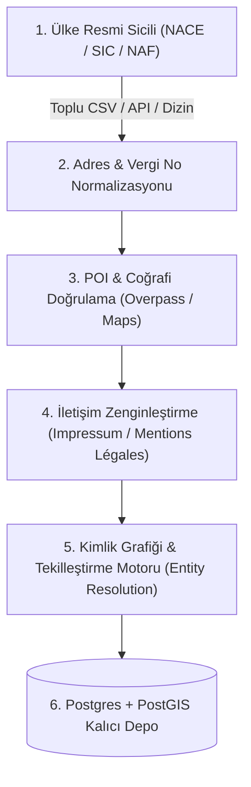

# B2B Veri Kazıma & Şirket Kimlik Grafiği Strateji Planı
> **Kapsam:** Global ve Türkiye B2B Denizcilik, Tekne & Yat Tasarımı, Tersane ve Mühendislik Veri Boru Hattı

---

## 0. Scrapling Nerede İşe Yarar, Nerede Yaramaz?

Scrapling'in gücü **anti-bot korumalarını aşma** ve **kırılan seçicileri (selector) kendi kendine onarma** tarafındadır:
- **`StealthyFetcher` / `StealthySession`:** Cloudflare Turnstile, Cloudflare Interstitial ve WAF engellerini bypass eder.
- **`DynamicFetcher`:** Headless browser ile dinamik JavaScript render eden portalları çözer.
- **`Adaptive Selectors`:** Hedef sitenin HTML DOM yapısı değiştiğinde akıllı eşleştirme ile doğru elementi otomatik olarak yeniden bulur.
- **`Spider` Altyapısı:** `robots_txt_obey` ve `crawldir` üzerinden oturum saklama ve artımlı (incremental) crawl imkânı sunar.

> [!IMPORTANT]
> **Doğru Aracı Seçmek:** Her veri kaynağı için Scrapling kullanmak gereksiz kaynak ve bant genişliği tüketir. Hedef tipine göre doğru araç seçilmelidir.

### Hedef Tipi ve Doğru Araç Matrisi

| Hedef Tipi | Örnek Kaynaklar | Doğru Araç | Neden? |
| :--- | :--- | :--- | :--- |
| **REST API** | Companies House, SIRENE, KVK, OpenRegister | `requests` / `httpx` | Doğrudan JSON döner, Scrapling overhead'ine gerek yoktur. |
| **Bulk CSV/XML/ZIP** | Companies House Snapshot, Sirene Bulk | `curl` / `wget` + `duckdb` / `pandas` | Milyonlarca satırı diskte streaming olarak işlemek en hızlısıdır. |
| **Klasik HTML Dizin & Sayfalama** | Stadtbranchenbuch, sektörel dizinler | `Fetcher` + `adaptive selector` | Hızlı HTML parse ve DOM değişikliklerine direnç. |
| **JS Render Eden Portallar** | MERSİS, İTO Bilgi Bankası, belediye portalları | `DynamicFetcher` / `DynamicSession` | Form submit ve AJAX render işlemlerini tarayıcı motoruyla çözer. |
| **Cloudflare / WAF Korumalı Siteler** | Ağır korumalı yabancı dizinler, tedarikçi listeleri | `StealthyFetcher` / `StealthySession` | Parmak izi gizleme, Turnstile ve JS challenge atlatma. |
| **Google Maps / Yandex Harita** | POI, koordinat, çalışma saatleri | Places API veya hazır scraper | Harita iç API'leri kırılgan olduğu için zenginleştirmede kullanılır. |

---

## 1. Ülke Bazlı Resmi Kayıtlar ve Açık Veri Envanteri

### 🇹🇷 Türkiye — En Zor Ülke (Ulusal Açık Veri Portalı Yok)
Türkiye'de merkezi ve toplu indirilebilir bir şirket açık veri seti bulunmamaktadır. Veriler dağınık, oturum korumalı veya form arkasındadır.

| Kaynak | Kapsam & İçerik | Erişim Biçimi | Not & Strateji |
| :--- | :--- | :--- | :--- |
| **MERSİS** | Tüm şirket/ticari işletme sicil kayıtları | Web Portal (Oturum zorunlu) | Resmi sicil kaynağı, API yok. `DynamicFetcher` ile form doldurma ve oturum yönetimi gerektirir. |
| **Türkiye Ticaret Sicili Gazetesi** | Tescil, unvan değişikliği, temsilci, terkin ilanları | Ücretli Veri Aboneliği (Düzey 1-2-3) | Toplu resmi veri için en gerçekçi yol; TOBB ile veri paylaşım protokolü. |
| **Oda Kayıtları (İTO, İZTO, ATO, BTSO)** | Üye firma listesi, NACE kodu, adres, durum | Web Form (Çoğu Captcha'lı) | Örneğin `eoda.izto.org.tr` veya İTO Bilgi Bankası unvan sorgusu. |
| **TOBB Sanayi Veritabanı** | ~70.000 üretici, kapasite raporu, ürün, çalışan bandı | Ücretsiz Abonelik + Oturum | Üretim, tersane ve ihracatçı hedeflemede altın değerindedir. |
| **TÜİK Veri Portalı** | Sektörel makro istatistikler | Açık Web / Portal | Firma bazlı değildir; ICP pazar büyüklüğü kıyaslaması için kullanılır. |
| **İBB Açık Veri Portalı** | İşyeri ruhsatları, istihdam, lojistik | Açık API | Şehir bazlı Türkiye'deki en olgun açık veri kaynağıdır. |
| **Diğer Belediyeler** | Ankara, Bursa, İzmir, Kocaeli açık veri dizinleri | Açık Portallar | `kaymal/acik-veri` dizini üzerinden takip edilir. |

> [!NOTE]
> **Türkiye Gerçeklik Notu:** Türkiye'de "tüm firmalar" havuzu kurmak için en sürdürülebilir yöntem Ticaret Sicili Gazetesi aboneliği almak ya da oda sitelerini hedefli olarak taramaktır. Oda sitelerini toplu kazımak oturum, captcha ve rate limit maliyetleri nedeniyle yavaş çalışır.

---

### 🇩🇪 Almanya — En Zengin Resmi + Açık Veri Ekosistemi

| Kaynak | Kapsam & İçerik | Erişim Biçimi | Not & Strateji |
| :--- | :--- | :--- | :--- |
| **handelsregister.de** | Resmi ticaret sicili, HRB/HRA, yöneticiler, ortaklar | Web (DiRUG sonrası ücretsiz) | Resmi API yoktur; `Scrapling / StealthyFetcher` tam buraya uygundur. |
| **OffeneRegister.de / OpenRegister** | Handelsregister'in CC BY 4.0 açık aynası | Açık REST API | Ücretsiz, yasal riski sıfır ve toplu alım için en rahat yol. |
| **Unternehmensregister / Bundesanzeiger** | Yıllık mali tablolar, bilanço bildirimleri | Web, kısmen açık | Finansal büyüklük ve ciro doğrulaması için. |
| **IHK Berlin Gewerbedaten** | ~350.000 işletme, sektör, hukuki form | Açık Veri (Aylık, WFS/GitHub) | Model veri seti; Hamburg, Köln, Münih IHK'leri için de geçerli. |
| **GovData** | Ulusal açık veri kataloğu | Açık Portal | Eyalet ve şehir veri portallarına tek noktadan erişim. |
| **Stadtbranchenbuch** | 5.6M+ işletme, telefon, web sitesi, adres | Klasik Web Dizini | İletişim zenginleştirmesi için mükemmel scraping hedefi. |

---

### 🇳🇱 Hollanda — KVK Merkezli, Açık Veri Kısıtlı

| Kaynak | Kapsam & İçerik | Erişim Biçimi | Not & Strateji |
| :--- | :--- | :--- | :--- |
| **KVK API** | Resmi Handelsregister sorguları, tam şirket kaydı | API Key (Ücretsiz katman var) | Ülkenin tek ve nihai resmi veri otoritesi. |
| **KVK Open Dataset (Basis Bedrijfsgegevens)** | Anonim temel veri, BV/NV tüzel kişilikler | Açık API + Toplu İndirme | İsim ve tam adres maskelenmiştir; kimlik grafiğinde tek başına yetersizdir. |
| **KVK Jaarrekeningen** | Yıllık mali tablolar (XML formatında) | Açık Bulk Veri | Bilanço ve finansal niyet sinyali çıkarımı. |
| **data.overheid.nl** | Ulusal açık veri portalı | Açık Web/API | Belediye ve bölgesel ticaret verileri. |
| **Telefoonboek.nl / Gouden Gids** | İşletme profili, telefon, e-posta, yetkili | Web Dizini | KVK kayıtlarını doğrudan iletişim verisiyle eşleştirmek için. |

---

### 🇬🇧 İngiltere — Açık Ara En Kolay ve Erişilebilir Ülke

| Kaynak | Kapsam & İçerik | Erişim Biçimi | Not & Strateji |
| :--- | :--- | :--- | :--- |
| **Companies House API** | Canlı şirket kayıtları, müdürler, tescil belgeleri | Ücretsiz API Key | 600 istek / 5 dakika sınırı; resmi ve anlık. |
| **Free Company Data Product** | Canlı tüm İngiliz şirketlerinin tam snapshot'ı | Açık CSV / ZIP İndirme | Tek dosyada ülkedeki tüm firmalar (~5 milyon satır). |
| **PSC Dosyası (Persons with Significant Control)** | Gerçek fayda sahipleri ve ortaklık payları | Açık JSON Bulk | B2B karar verici ve hissedar eşleştirmesi. |
| **FCA Register & Charity Commission** | Finans ve dernek sicilleri | Açık API | Finansal ve sektörel doğrulama. |
| **Yell.com** | İngiltere yerel işletme dizini, iletişim, web | Web Scraping | SMB/KOBİ seviyesinde güncel telefon ve web adresi. |

> [!TIP]
> **Lisans Güvencesi:** Companies House verisi **OGL (Open Government Licence)** altındadır; ticari ürünlerde kaynak belirtilerek tamamen ücretsiz kullanılabilir.

---

### 🇫🇷 Fransa — SIRENE ile Zengin ve Yapısal Kaynaklar

| Kaynak | Kapsam & İçerik | Erişim Biçimi | Not & Strateji |
| :--- | :--- | :--- | :--- |
| **API Sirene (INSEE)** | 1973'ten beri tüm işletme ve şube kayıtları | Ücretsiz API Key | Saniyede 7 istek limitli resmi API. |
| **Base Sirene Bulk** | Aylık tam şirket veritabanı snapshot'ı | Açık İndirme (CSV) | Milyonlarca Fransız işletmesini yerel veritabanına aktarmak için. |
| **API Recherche d'Entreprises** | İsim, NAF kodu, adres ve Siren/Siret sorgusu | Tokensız Açık API | Maksimum 10.000 sonuç tavanı; anlık zenginleştirme için ideal. |
| **INPI RNE / Data INPI** | Ulusal işletmeler sicili, tüzükler, bilançolar | Ücretsiz SFTP + API | Hissedar, imza yetkilisi ve mali tablolar için. |
| **BODACC** | İflas, konkordato, unvan devri, sermaye artışı | Açık Veri | Satın alma niyeti veya risk erken uyarı sinyali. |
| **PagesJaunes** | Fransız işletme rehberi, yerel iletişim verileri | Web Dizin Scraping | Doğrulanmış telefon ve web sitesi adresleri. |

---

## 2. Ülke-Üstü ve Sınır Ötesi Açık Veri Kaynakları

1. **GLEIF LEI (`api.gleif.org`):**
   - **Lisans:** CC0 (Tamamen kamu malı).
   - **İçerik:** Uluslararası tüzel kişi kimliği (LEI), ana şirket - bağlı ortaklık ilişkileri grafiği.
2. **OpenCorporates (`api.opencorporates.com`):**
   - **İçerik:** 200 milyondan fazla şirket, 100'den fazla yetki alanı; tüzel kişi tekilleştirmede global referans.
3. **Overture Maps & OpenStreetMap Overpass (`overpass-turbo.eu`):**
   - **İçerik:** Global POI (Point of Interest) katmanı, tersane koordinatları, limanlar. Google Maps'e göre ücretsiz ancak kapsama oranı %60–70 seviyesindedir.
4. **AB VIES (`ec.europa.eu/taxation_customs/vies`):**
   - **İçerik:** Avrupa Birliği KDV (VAT) numarası doğrulama servisi; sahte/inaktif şirketleri elemek için kritik.
5. **e-Justice BRIS (`e-justice.europa.eu`):**
   - **İçerik:** AB üye devletlerinin ticaret sicillerini birbirine bağlayan resmi tek kapı platformu.

---

## 3. Google Maps Yolu, Maliyetleri ve Hukuki Durum

| Yöntem | Yaklaşık Maliyet | Avantajları | Dezavantajları & Riskler |
| :--- | :--- | :--- | :--- |
| **Google Places API** *(Resmi Yol)* | Text Search ~$32 / 1.000 çağrı<br>Yorum Detay ~$40 / 1.000 çağrı<br>*(5.000 kayıt ≈ $245)* | Google Hizmet Şartlarına (ToS) %100 uyumlu, stabil, sıfır IP engelleme. | E-posta adresi vermez. Yorum saklama sınırı 30 gündür, en fazla 5 yorum döner. Pahalıdır. |
| **Hazır Scraper API'leri** *(Outscraper, SerpApi, Bright Data)* | $0,006 – $18,60 / 1.000 kayıt *(Ortalama ~$1,50 / 1.000)* | Web sitesi, e-posta, sosyal medya ve tüm yorumları zenginleştirilmiş verir. | Fiyatlar arasında 3.000 kata varan fark vardır. Hukuki risk sağlayıcıya aittir ancak gri alandadır. |
| **Kendi Scrapling Botun** *(StealthyFetcher)* | Sadece Proxy & Sunucu Maliyeti | Minimum maliyet, tam veri kontrolü. | Google'ın anti-bot güncellemelerine karşı kırılgandır, sık bakım gerektirir. |

> [!WARNING]
> **Altın Kural:** Google Maps asla birincil kayıt kaynağı yapılmamalıdır. Önce resmi sicillerden şirket listesi (tüzel kişi varlığı) çekilmeli, ardından Google Maps / Overpass sadece **iletişim zenginleştirme (telefon, çalışma saati, koordinat, puan)** için kullanılmalıdır.

---

## 4. Somut Uçtan Uca B2B Veri Boru Hattı



### Aşama Detayları:
1. **Resmi Sicilden Çıkarma:**
   - Birleşik Krallık: Companies House Bulk CSV → SIC `30.11` & `30.12` filtresi.
   - Fransa: Base Sirene Bulk → NAF `30.12Z` (Yat ve tekne yapımı).
   - Almanya: OpenRegister API → WZ Kodu `30.12`.
   - Hollanda: KVK API / Açık Veri.
   - Türkiye: MERSİS / Ticaret Sicili Gazetesi / Oda sorguları.
2. **Adres Normalizasyonu:** Cadde, ilçe, posta kodu ayrıştırma ve koordinat tespiti (Geocoding).
3. **POI Zenginleştirme:** OSM Overpass üzerinden tersane sahası kontrolü, gerektiğinde Maps API.
4. **Hukuki Sayfa Taraması (En Yüksek Verim):**
   - Almanya'da **`Impressum`**, Fransa'da **`mentions légales`** sayfaları kanunen zorunludur.
   - Tüm web sitesini taramak yerine sadece bu sayfaları `Scrapling` ile çekmek, şirket yöneticisi, doğrulanmış e-posta ve santral telefonunu doğrudan verir.
5. **Deterministik Tekilleştirme:** VKN / KVK / SIREN / VAT / LEI numaraları ile tekil `company_id` oluşturma.

---

## 5. Scrapling Temel Kod İskeleti

Aşağıdaki şablon, adaptive seçiciler ve oturum desteği ile dayanıklı bir sicil/dizin tarayıcısı sağlar:

```python
"""
NautiGraph B2B - Scrapling Dayanıklı Sicil ve Dizin Tarayıcısı
"""
import asyncio
from scrapling.fetchers import StealthySession, DynamicSession
from scrapling.spiders import Spider


class MaritimeRegistrySpider(Spider):
    name = "maritime_registry"
    start_urls = [
        "https://ornek-ticaret-odasi-dizini.org/sektor/yat-tasarim",
    ]
    crawldir = "./crawlstate"
    robots_txt_obey = True
    concurrent_requests = 4
    
    # Adaptive selector yapılandırması: DOM değişse bile elementi korur
    selector_config = {
        "adaptive": True,
        "auto_save": True
    }

    async def parse(self, response):
        # Şirket listesi satırlarını ayrıştır
        for row in response.css("table.company-results tr.item"):
            company_data = {
                "legal_name": row.css("td.name::text").get(),
                "city": row.css("td.city::text").get(),
                "tax_no": row.css("td.vkn::text").get(),
                "detail_url": response.urljoin(row.css("a.detail-link::attr(href)").get()),
            }
            
            # Detay sayfasına takip isteği gönder
            if company_data["detail_url"]:
                yield response.follow(
                    company_data["detail_url"],
                    callback=self.parse_detail,
                    meta={"company": company_data}
                )

        # Sonraki sayfa takibi
        next_page = response.css("a.pagination-next::attr(href)").get()
        if next_page:
            yield response.follow(next_page, callback=self.parse)

    async def parse_detail(self, response):
        company = response.meta["company"]
        # İletişim ve web sitesi zenginleştirmesi
        company["website"] = response.css("a.official-web::attr(href)").get()
        company["phone"] = response.css("span.phone-number::text").get()
        company["email"] = response.css("a[href^='mailto:']::text").get()
        
        yield company


# =============================================================================
# Cloudflare ve Dinamik Portallar İçin Özel Oturumlar
# =============================================================================

async def fetch_cloudflare_protected_directory(target_url: str):
    """
    Cloudflare Turnstile veya WAF arkasındaki dizinleri aşmak için StealthySession kullanımı.
    """
    async with StealthySession(solve_cloudflare=True, humanize=True, geoip=True) as session:
        response = await session.get(target_url)
        return response.adaptive_select("div.supplier-card")


async def fetch_dynamic_portal_with_login(login_url: str, target_url: str, credentials: dict):
    """
    Oturum ve JavaScript gerektiren Türk kamu/oda portalları için DynamicSession kullanımı.
    """
    async with DynamicSession(headless=True) as session:
        # 1. Giriş yap
        await session.goto(login_url)
        await session.fill("#username", credentials["user"])
        await session.fill("#password", credentials["pass"])
        await session.click("#btn-login")
        await session.wait_for_selector(".user-dashboard")
        
        # 2. Yetkili oturumla hedef dizini çek
        response = await session.goto(target_url)
        return response.css("table.registry-list")
```

---

## 6. Proje Entegrasyon Notları (NautiGraph TR)

1. **`business_manager/app.py` Entegrasyonu:**
   Toplayıcı kuyruk motoru (`CRAWLER_STATE`), yukarıdaki akışa göre ülke seçildiğinde ilgili boru hattını devreye alır:
   - `Türkiye` seçildiğinde: `musteri_listesi.json` yerel sicil verisi + Sanayi veritabanı.
   - `İngiltere` seçildiğinde: Companies House Bulk CSV ve REST API.
   - `Almanya` seçildiğinde: OpenRegister API + Impressum crawl.
   - `İtalya & Hollanda` seçildiğinde: KVK / Registro Imprese ve sektörel fuar katılımcı listeleri.

2. **Hukuki Dayanak (KVKK & GDPR):**
   Tüzel kişi tacir kayıtları kamuya açık sicil kapsamındadır. Ancak web sitelerinden çekilen şahıs iletişimleri için **meşru menfaat denge testi (KVKK md. 5/2-f / GDPR Art. 6/1-f)** kayıt altına alınmalı ve **İYS / ROKS** ret mekanizması açık tutulmalıdır.
---

## 7. Beş Ülkede Şirket Veritabanları ve Açık Veri Kaynaklarından Veri Toplama Rehberi: Scrapling ve Kazımasız Mimari

Türkiye, Almanya, Hollanda, İngiltere ve Fransa genelinde şirket ve fiziksel işletme verisi toplamanın en verimli yolu, her siteyi Web Scraping ile kazımaya çalışmak değil; resmi açık veri yığınlarını (toplu CSV, Parquet, SQLite dosyaları ve ücretsiz devlet API'lerini) doğrudan indirip **Scrapling'i yalnızca toplu indirme veya açık API sunmayan ticaret odaları, yerel belediye listeleri ve kurumsal web sitesi doğrulamaları için devreye almaktır.**

- **İngiltere (Companies House ve FSA)** ile **Fransa (INSEE Sirene)**: Neredeyse tüm ticari sicil ve gıda/hizmet işletmesi kayıtlarını ücretsiz, makine okunabilir ve ticari yeniden kullanıma açık biçimde sunar.
- **Almanya:** Resmi sicili (`handelsregister.de`) kullanım şartlarıyla toplu çekimi kısıtladığından sivil toplum girişimi **OffeneRegister.de** ve Berlin Sanayi ve Ticaret Odası (**IHK Berlin**) açık CSV veri setleri öne çıkar.
- **Hollanda:** **KVK arama API'si** ücretsizdir (€0); şirket detayları ise sorgu başına çok düşük bir ücrete (€0,02) tabidir.
- **Türkiye:** Tüm ülkeyi kapsayan merkezi bir açık sicil yığını bulunmadığından **İTO, İZTO, BTSO ve ATSO** gibi oda portallarında Scrapling tabanlı oturum ve ağ yakalama mimarisi ana rolü üstlenir.

### POI (İlgi Çekici Nokta) Katmanı ve Maliyetsizleştirme
Google Maps benzeri fiziksel işletme (POI – Point of Interest) verileri için Google Places API'ye yüksek faturalar ödemek veya üçüncü parti Maps kazıyıcılarına bağımlı kalmak yerine:
1. **Overture Maps Places** (Ekim 2026 sürümünde 88.418.121 küresel yer kaydı)
2. **Foursquare OS Places** (100 milyonun üzerinde küresel POI)

açık kaynak veri setlerini temel katman olarak kullanmak edinim maliyetini sıfıra indirir. Resmi devlet sicilleri çoğunlukla yasal unvan, NACE/SIC/NAF faaliyet kodu ve sicil adresini verirken telefon, e-posta ve web sitesi içermez; bu nedenle en sağlam mimari, **açık POI veri setleri ile resmi sicil tablolarını birleştirip yalnızca eksik web ve iletişim alanlarını Scrapling ile tamamlamaya dayanır.**

---

## 8. Scrapling Mimarisi: Ne Zaman Kazıma, Ne Zaman Doğrudan API veya Toplu İndirme?

Scrapling, Python 3.10 ve üzeri ortamlarda (`pip install "scrapling[all]"` ve tarayıcı bağımlılıkları için `scrapling install`) çalışan, hem yüksek hızlı HTTP istemcisi hem de tam tarayıcı otomasyonu sunan uyarlanabilir bir veri kazıma çerçevesidir. Üç çekirdek çekme motoru sayesinde hedef sitenin teknik korumasına göre düşük maliyetten yüksek gizliliğe doğru kademeli geçiş yapılır.

### Scrapling Bileşenleri ve Karar Matrisi

| Scrapling Bileşeni | Altyapı ve Temel Yetenekler | Uygun Olduğu Hedef Kaynak Türü | Maliyet ve Ölçek Sınırı |
| :--- | :--- | :--- | :--- |
| **Fetcher / AsyncFetcher** | Tarayıcı TLS parmak izi taklidi, HTTP/3 desteği, `FetcherSession` ile çerez/oturum yönetimi. | Statik HTML tabloları, açık veri katalogları, hafif belediye sayfaları ve doğrudan JSON uç noktaları. | En düşük RAM/CPU tüketimi; `asyncio` ile çok yüksek eşzamanlılık. |
| **DynamicFetcher / DynamicSession** | Optimize edilmiş `patchright` tabanlı Chromium/Chrome çalıştırma, `wait_selector` ve sekme havuzuyla eşzamanlı gezinme. | ASP.NET WebForms (İZTO), JavaScript ile yüklenen tablolar ve istemci tarafı render gerektiren oda portalları. | Orta-yüksek bellek kullanımı; `wait_selector` olmadan boş iskelet dönebilir. |
| **StealthyFetcher / StealthySession** | Modifiye edilmiş Camoufox motoru, gerçek tarayıcı parmak izi enjeksiyonu, `solve_cloudflare=True` ile otomatik Cloudflare Turnstile/Interstitial aşımı, yaklaşık 3.500 reklam/izleyici alan adını engelleme ve Cloudflare DoH ile DNS sızıntısı önleme. | Cloudflare Turnstile/Interstitial veya sıkı bot tespiti uygulayan ticaret odaları ve kurumsal web siteleri. | Tarayıcı tabanlı olduğu için yüksek hacimli eşzamanlı taramalarda yüksek kaynak tüketir. |
| **Arka Plan API Yakalama (`record_requests=True`)** | Tarayıcı oturumunda arka plandaki ağ yanıtlarını kaydeder ve `session.network.search()` ile metin/JSON gövdelerini tekrar istek atmadan okur. | Oda arama sayfalarının arka planda çağırdığı gizli JSON/API uç noktalarını HTML ayrıştırmadan doğrudan çekmek. | Sınırlı geçmiş belleği tutar; karmaşık DOM seçicisi yazma ihtiyacını tamamen ortadan kaldırır. |
| **Uyarlanabilir Ayrıştırma (`adaptive=True`) & MCP** | `auto_save=True` ile öğe parmak izini kaydeder; sayfa şablonu değişse bile öğeyi benzerlik üzerinden yeniden bulur. Dahili Spider çerçevesi ve AI token maliyetini düşüren MCP sunucusu içerir. | Tasarımı sık güncellenen dizinler ve şirket web sitelerinden iletişim verisi çıkarma iş akışları. | Parmak izinin ilk çalıştırmada başarıyla kaydedilmiş olması şarttır. |

> [!CAUTION]
> **Anti-Bot ve Ölçek Sınırları:**
> Büyük ölçekli taramalarda `ProxyRotator` ile döngüsel proxy rotasyonu ve `cdp_url` üzerinden uzak tarayıcı bağlantısı doğrudan desteklenir. Bununla birlikte Akamai, DataDome, Kasada ve Incapsula gibi kurumsal koruma katmanlarında harici antibot token çözücüleri gerekir. Resim/metin tabanlı güvenlik kodu (CAPTCHA) soran formlarda da Cloudflare Turnstile otomasyonu tek başına yeterli olmaz. Devletlerin doğrudan CSV, Parquet veya REST API sunduğu durumlarda Scrapling kullanmak gereksiz bakım ve sunucu maliyeti doğurur.

---

## 9. Google Maps Alternatifleri ve Küresel Açık İşletme Veri Setleri

Fiziksel işletmelerin konum, kategori, çalışma saatleri ve marka bilgilerini toplamak için Google Places API'ye veya harita kazıyıcılarına bağımlı kalmadan açık lisanslı küresel POI veri setleri birincil kaynak olarak kullanılmalıdır.

Google Maps Platformu, 1 Mart 2025 itibarıyla eski aylık 200 USD sabit krediyi kaldırarak SKU başına aylık ücretsiz kullanım limitlerine geçmiştir (Essentials SKU'ları için 10.000, Pro için 5.000, Enterprise için 1.000 ücretsiz olay). Ayrıca Place Details veya Text Search çağrılarında tek bir üst katman alanının istenmesi tüm çağrının o üst katmandan faturalandırılmasına yol açar.

### Küresel POI Kaynakları Karşılaştırması

| Küresel Kaynak / API | Kapsam ve Veri Hacmi | Lisans ve Erişim Yöntemi | Maliyet Modeli | Bilinen Eksikler ve Kalite Notları |
| :--- | :--- | :--- | :--- | :--- |
| **Overture Maps Places** *(AWS, Meta, Microsoft, TomTom)* | Ekim 2026 sürümünde **88.418.121 yer**, 2,53 milyar bina, 475 milyon adres. Başlıca kaynaklar: Meta (61,27M), BrightQuery (16,77M), Microsoft (5,86M), Foursquare (3,61M), AllThePlaces (1,97M). | **CDLA-Permissive-2.0, Apache-2.0 ve CC0-1.0** (Places teması OpenStreetMap verisi ve ODbL paylaşım zorunluluğu içermez). AWS S3, Azure Blob ve BigQuery (`bigquery-public-data.overture_maps.place`) üzerinden aylık sürüm. | **Ücretsiz** *(Ticari kullanım tamamen serbest).* | Tekrar eden kayıtlar (duplicate), düşük özellik doluluğu ve çöp veri içerebilir; `confidence` skoru ile filtrelenmelidir. İşletmelerin %4,5'inde eksik adres bulunur. |
| **Foursquare OS Places** | **100M+ küresel POI**, 200+ ülke ve bölge, 1.000+ kategori, 20–22 temel nitelik (saatler, puanlar vb.). | **Apache-2.0**; açık kaynak indirme ve DuckDB / SQLRooms / Kepler.gl ekosistemi. | **Ücretsiz** *(Ticari kullanım serbest).* | Küresel kayıtların yaklaşık %40'ının güncelliğinin yenilenmesi veya doğrulanması gerekebilir. |
| **OpenCorporates API** | Çok ülkeli yasal şirket sicilleri ve yönetici verileri. | Kamu yararı projelerine açık/share-alike; ticari kullanım lisanslıdır. | Ücretsiz plan (~50 istek/gün, 200/ay); ticari planlar £225/ay (500 çağrı) ile £1.200/ay (5.000 çağrı) arasındadır. | Yüksek hacimli ticari ülke taramaları için maliyetlidir; ulusal açık siciller varken aracı olarak kullanılmamalıdır. |
| **Google Places API (New)** *(Resmi)* | Küresel ticari POI, iletişim ve atmosfer verileri. | Resmi REST API; alan maskesi (`field mask`) ile çağrı. | Aylık ücretsiz kota sonrası ilk kademede 1.000 olay başına: Details Essentials $5,00, Details Pro $17,00, Text Search Pro $32,00. 1.000 yer maliyeti ~$6,60–$18,60 düzeyindedir. | Arama başına en fazla 20 yer döner; pahalıdır ve e-posta adresi vermez. |
| **Üçüncü Parti Maps SERP / Kazıyıcı API'ler** | Google Maps arama sonuçları ve zenginleştirilmiş işletme satırları. | Yönetilen API (DataForSEO, ScrapingDog, SerpApi, Apify, Outscraper, Bright Data). | En düşük tarifelerde 1.000 yer başına ham SERP satırı ~$0,006–$0,098, zenginleştirilmiş kayıt $0,40–$1,30 aralığındadır. | Kendi tarayıcı altyapınızı yönetmek yerine tercih edilebilir. |

> [!TIP]
> **Placekey Standardı:** Açık POI katmanını güçlendirmek için Overture Maps Places ile Foursquare OS Places veri setleri Placekey standardı veya coğrafi/isim eşleştirmesiyle birleştirilebilir. İki veri seti arasında yaklaşık 7.868.660 doğrudan kayıt çakışması tespit edilmiştir.

---

## 10. Beş Hedef Ülkenin Şirket Veritabanları ve Büyük Şehir Portalları Karşılaştırması

Avrupa Birliği'nde Yüksek Değerli Veri Setleri (HVD) Yönetmeliği (AB) 2023/138, kamu kurumlarının şirket mülkiyeti dahil belirlenen veri setlerini 9 Haziran 2024'ten itibaren ücretsiz, makine okunabilir, API ve toplu indirme kanallarıyla sunmasını zorunlu kılmıştır. Ancak üye ülkeler arasındaki teknik olgunluk farkı veri toplama stratejisini belirler:

| Ülke | Ana Şirket Veritabanı *(Scrapling Olmadan)* | Scrapling Gerektiren Ana / Oda Kaynakları | İletişim Bilgisi Durumu | 5 Büyük Şehir Kapsamı ve Durumu |
| :--- | :--- | :--- | :--- | :--- |
| **Türkiye** | Merkezi toplu indirme yok; ULASAV (`ulasav.csb.gov.tr`) ekonomi etiketinde 264 set indeksler. | Ticaret Sicili Gazetesi, MERSİS / TOBB, İTO, İZTO, BTSO, ATSO. | Oda portallarında kısmi iletişim/sicil bilgisi bulunur; bazı formlar giriş veya güvenlik kodu ister. | İstanbul, İzmir, Bursa, Antalya, Ankara belediye portalları aktif; ATO doğrudan üye sorgu uç noktası doğrulanmadı. |
| **Almanya** | OffeneRegister.de (250 MB JSON / 740 MB SQLite), GovData.de, Destatis, open-data-germany.org. | `handelsregister.de` (kullanım şartları toplu çekimi ve serbest yeniden kullanımı kısıtlar). | Resmi sicilde telefon/e-posta/web yoktur; turizm/restoran POI'leri için open-data-germany.org ve Overture/FSQ kullanılır. | Berlin (IHK Berlin CSV), Hamburg, Münih güçlü portallara sahip; Köln ve Frankfurt için müstakil portal URL'si doğrulanmadı. |
| **Hollanda** | KVK API (Zoeken €0; profiller €0,02/sorgu), KVK Jaarrekeningen (ücretsiz XBRL, anonim), ulusal portal (22.900+ set). | Düşük maliyetli resmi API ve açık POI katmanları sayesinde öncelikli Scrapling hedefi gerektirmez. | KVK açık finansal sette firma adı ve KVK numarası gizlidir; temel API profilleri adres/sicil odaklıdır. | Amsterdam, Rotterdam, Den Haag, Eindhoven portalları doğrulandı; Utrecht doğrudan KVK API ve ulusal portal ile kapsanır. |
| **İngiltere** | Companies House (Aylık ~471 MB CSV/ZIP, günlük PSC JSON, günlük XBRL, ücretsiz REST & Streaming API) + FSA FHRS/FHIS API. | Dağınık belediye NNDR (Business Rates) sayfalarından XLSX/CSV bağlantısı toplama ve kurumsal web siteleri. | Companies House yönetici ve sicil adresi verir, telefon/e-posta/web vermez; FSA işletme tabela adını ekler. | Londra (London Datastore + ilçe NNDR) ve Leeds (Data Mill North) doğrulandı; Birmingham, Manchester, Glasgow ulusal API ve NNDR üzerinden çekilir. |
| **Fransa** | Base Sirene (INSEE) (`data.gouv.fr` üzerinden aylık Parquet/CSV) + API Recherche d'entreprises + API Sirene. | Şirket web sitelerinden marka ve iletişim bilgisi kazıma. | Sirene telefon, e-posta, web sitesi ve tüzel kişi yöneticisi içermez (statut P gizlidir). | Paris, Marsilya, Lyon, Toulouse, Nice için müstakil belediye portalına gerek yoktur; Sirene ve API Recherche coğrafi/IRIS düzeyinde tüm kentleri kapsar. |

---

## 11. Beş Ülkenin Derinlemesine Detay Analizi ve Şehir Düzeyi Veri Kaynakları

### 🇹🇷 Türkiye
Türkiye'de İngiltere veya Fransa'daki gibi tüm aktif şirketleri tek bir açık CSV veya Parquet dosyası olarak indirmeye izin veren merkezi bir açık sicil veri seti bulunmamaktadır. Bu nedenle Türkiye, il ticaret odaları ve merkezi sicil arayüzleri üzerinden Scrapling ile veri toplanması gereken başlıca ülkedir.
- **Merkezi Düzey:**
  - **Türkiye Ticaret Sicili Gazetesi (`ticaretsicil.gov.tr`):** `unvansorgulama.php` ve `ilangoruntuleme.php` sayfaları sunsa da detaylı erişim için oturum açma ("GİRİŞ YAPMALISINIZ") şartı uygular.
  - **MERSİS (`mersis.tobb.org.tr`) & Sanayi Veritabanı (`sanayi.org.tr`):** Halka açık toplu API yerine e-Devlet giriş ekranlarına dayalıdır.
  - **ULASAV (`ulasav.csb.gov.tr`):** Ekonomi kategorisi altında 264 belediye veri setini indeksler.
- **Büyük Şehirler ve Odalar:**
  - **İstanbul (İTO):** İTO Bilgi Bankası (`bilgibankasi.ito.org.tr/tr/bilgi-bankasi/firma-bilgileri`) ve `guncelle.ito.org.tr` üzerinden sorgu yapılır. Güvenlik kodu bulunmayan Bilgi Bankası akışlarında Scrapling `StealthySession` ve `record_requests=True` kullanılarak arka plan XHR API çağrıları doğrudan yakalanabilir. İBB Açık Veri Portalı (`data.ibb.gov.tr`) ve ilçe portalları (Tuzla, Kadıköy vb.) ek katman sağlar.
  - **İzmir (İZTO):** `eportal.izto.org.tr/web/Uye_Firmalar_Yeni.aspx` Oda Sicil No gibi ölçütlerle sorgu yapan ASP.NET WebForms arayüzüdür ve `DynamicSession` ile viewstate/durum yönetimi gerektirir. İzmir BB Açık Veri Portalı (`acikveri.bizizmir.com`) CC BY 4.0 ile ticari kullanıma açıktır.
  - **Bursa (BTSO):** `btso.org.tr/hizmetler/online-islemler/kayitli-uyeler` ve Bursa Açık Yeşil Platformu.
  - **Antalya (ATSO):** `atso.org.tr/tr/company/` unvan, vergi no, MERSİS no, ticaret sicil no ve oda sicil no ile beş ayrı alandan sorgulama sunarak Scrapling için en yapılandırılmış hedeflerden birini oluşturur; belediye verileri `acikveri.antalya.bel.tr` adresindedir.
  - **Ankara:** Ankara BB Şeffaflık Portalı (`seffaf.ankara.bel.tr`) mevcuttur.

---

### 🇩🇪 Almanya
Almanya'da resmi ticaret sicili yasal şartlar bakımından kısıtlayıcı olsa da sivil toplum destekli açık veri yığınları ve Berlin örneği sayesinde Scrapling olmadan geniş ölçekli şirket verisi toplanabilir.
- **Ulusal Veri Yığınları:**
  - **OffeneRegister.de:** Open Knowledge Foundation Deutschland ve OpenCorporates ortaklığıyla Alman Handelsregister verilerini tek seferde ~250 MB bzip2 (line-delimited JSON) veya FTS5 tam metin indeksli ~740 MB gzip (SQLite) dosyaları halinde ve REST API ile ücretsiz sunar. Eyalet mahkemesi adlandırma varyasyonlarına dikkat edilmelidir.
  - **Resmi Sicil (`handelsregister.de`):** Kuzey Ren-Vestfalya Adalet Bakanlığı kullanım şartları toplu indirmeyi ve serbest ticari yeniden kullanımı yasaklar.
  - **GovData.de & Destatis:** Federal katalog, istatistikler ve `open-data-germany.org` turizm/restoran Knowledge Graph POI setleri.
- **Büyük Şehirler:**
  - **Berlin:** IHK Berlin Açık Veri Portalı (`ihk.de/berlin/...`), güncel ticari işletme verilerini (`aktuelle Gewerbedaten`) doğrudan CSV ve GitHub deposu olarak yayımlar. LOR mekansal anahtarları ve posta kodlarıyla eşleştirilebilir.
  - **Hamburg:** Urban Data Platform Hamburg (`en.urbandataplatform.hamburg`) ve GovData entegrasyonu.
  - **Münih:** `opendata.muenchen.de` üzerinde 330'dan fazla veri seti.
  - **Frankfurt & Köln:** OffeneRegister.de, GovData.de ve Overture/Foursquare katmanlarından posta kodu ve şehir filtreleriyle çekilir.

---

### 🇳🇱 Hollanda
Hollanda'da ticaret sicili KVK (Kamer van Koophandel) tarafından yönetilir ve ücretsiz açık veri ile düşük maliyetli resmi API net biçimde ayrılmıştır. Ticari liste sağlayıcılarının 1.000 B2B adres için ~€386 istediği bu pazarda en akılcı model:
- **KVK Developer API (`developers.kvk.nl/pricing`):**
  - **Zoeken (Arama) API:** Sorgu başına **€0 (Tamamen Ücretsiz)**.
  - **Basisprofiel, Vestigingsprofiel ve Naamgeving:** Sorgu başına yalnızca **€0,02**.
  - **Strateji:** Overture veya Foursquare ile saptanan işletmeler önce ücretsiz Zoeken API'siyle KVK numarasına bağlanır; yalnızca geçerli kayıtlar için €0,02 karşılığında resmi profil çekilir.
- **KVK Open Dataset Jaarrekeningen:** 8 parça ZIP/XML halinde XBRL bilançoları sunar ancak firma adı ve KVK numarası gizli (anonim) olduğu için firma rehberi oluşturmada tek başına yetersizdir.
- **Şehir Portalları:** Amsterdam Open Data, Rotterdam Stadsarchief (`stadsarchief.rotterdam.nl`), Den Haag (`denhaag.nl`) ve Eindhoven (`data.eindhoven.nl`).

---

### 🇬🇧 İngiltere
İngiltere, hem kurumsal sicil hem de yerel işletme kayıtları bakımından Scrapling olmadan eksiksiz veri toplanabilen en zengin ekosistemdir.
- **Companies House (OGL Lisansı):**
  - **Free Company Data Product:** Her ay sonu güncellenen `BasicCompanyDataAsOneFile-YYYY-MM-01.zip` paketi (~471 MB ZIP, açıldığında ~2 GB CSV) ile ~5 milyon aktif İngiliz şirketini tek dosyada sunar.
  - **PSC Snapshot (Gerçek Fayda Sahipleri):** Günlük JSON formatında açık indirme.
  - **Accounts Data Product:** Yıllık ~2,2 milyon bilançonun %60'ını iXBRL/XBRL ZIP olarak ücretsiz sunar.
  - **REST API:** 5 dakikada 600 istek limitiyle canlı doğrulama.
- **Food Standards Agency (FSA) FHRS/FHIS API (`data.food.gov.uk`):**
  - Hesap veya API key istemez (sadece `x-api-version` başlığı yeterlidir).
  - Tabela adları (trading name), hijyen puanları, kafe, restoran, pub, gıda marketi ve otellerin adres kayıtlarını JSON/XML olarak döner.
- **NNDR (Business Rates) Açık Verisi:**
  - Yerel belediyeler ticari mülkleri, vergi matrahlarını (rateable value) ve tüzel kişi şirket adlarını XLSX/CSV olarak yayımlar. Londra Datastore (`data.london.gov.uk`), Leeds (`datamillnorth.org`) örneklerdendir. Dağınık NNDR sayfalarındaki dosya bağlantılarını toplamak için hafif bir Scrapling Fetcher örümceği yeterlidir.

---

### 🇫🇷 Fransa
Fransa, INSEE Base Sirene ve merkezi arama API'leri sayesinde Scrapling olmadan tam kapsamlı işletme verisi toplanabilen birincil ülkedir.
- **Base Sirene (INSEE) (`data.gouv.fr` — Licence Ouverte 2.0):**
  - 1973'ten beri tüm şirketleri (9 haneli SIREN) ve şubeleri (14 haneli SIRET) kapsar (~30 milyon işletme, ~43 milyon şube).
  - Aylık Parquet ve CSV formatında sunulur (~985 MB sıkıştırılmış boyut). 2027 itibarıyla CSV sonlandırılarak tamamen Parquet formatına geçilecektir.
  - Baştaki sıfırların kaybolmaması için SIREN, SIRET ve posta kodları metin (`string`) olarak saklanmalıdır.
  - NAF/APE faaliyet kodları (NAF 2025 geçişi dahil) ve çalışan bantları yer alır. Telefon/e-posta içermez.
- **Merkezi API'ler:**
  - **API Recherche d’entreprises (`data.gouv.fr`):** Şirket yöneticileri (dirigeants), coğrafi arama ve RNE pazarlama itirazı kontrolü için token gerektirmeyen açık API.
  - **API Sirene (INSEE):** Günlük tescil ve unvan değişimlerini yakalamak için resmi API.
- **Şehir Kapsamı:** Paris, Marsilya, Lyon, Toulouse ve Nice için belediye portallarına gerek kalmaksızın tüm işletmeler Base Sirene içinde INSEE komün kodu ve 15.500 IRIS istatistik bölgesi düzeyinde adres koordinatlarıyla haritalanabilir.

---

## 12. Uçtan Uca Hibrit Veri Toplama ve Zenginleştirme Boru Hattı

Beş ülkede hem resmi sicil doğruluğunu hem de fiziksel işletme ve iletişim zenginliğini en düşük maliyetle birleştiren 3 aşamalı mimari:

```
┌─────────────────────────────────────────────────────────────────────────────┐
│ AŞAMA 1: RESMİ SİCİL OMURGASI (KAZIMASIZ / ZERO-SCRAPE)                     │
│ UK: Companies House Bulk CSV + PSC │ FR: Base Sirene Parquet                │
│ DE: OffeneRegister.de SQLite       │ NL: KVK Zoeken API (€0)                │
└──────────────────────────────────────┬──────────────────────────────────────┘
                                       │
                                       ▼
┌─────────────────────────────────────────────────────────────────────────────┐
│ AŞAMA 2: AÇIK KAYNAK POI KATMANI EŞLEŞTİRMESİ                               │
│ Overture Maps Places (88.4M) + Foursquare OS Places (100M)                  │
│ -> Konum, tabela adı, kategori, çalışma saatleri ve mevcut telefon/web       │
└──────────────────────────────────────┬──────────────────────────────────────┘
                                       │
                                       ▼
┌─────────────────────────────────────────────────────────────────────────────┐
│ AŞAMA 3: HEDEFLİ SCRAPLING OTOMASYONU                                       │
│ 1. Türkiye Odaları: İTO, İZTO, ATSO, BTSO (StealthySession + Network API)   │
│ 2. UK NNDR Sayfaları: Değişken XLSX/CSV link toplayıcı                      │
│ 3. Firma Web Siteleri: Impressum & Mentions Légales sayfalarından e-posta/tel│
└─────────────────────────────────────────────────────────────────────────────┘
```

1. **Aşama 1 — Resmi Sicil Omurgasını Kazımasız Kurma:**
   - İngiltere için Companies House aylık `BasicCompanyData` + günlük PSC + FSA API.
   - Fransa için INSEE Sirene Parquet dosyaları + `API Recherche d'entreprises`.
   - Almanya için OffeneRegister.de SQLite/JSON + IHK Berlin CSV.
   - Hollanda için ücretsiz KVK Zoeken API'si (€0).
   - Veriler doğrudan indirilerek Postgres tablosuna aktarılır.
2. **Aşama 2 — Açık Kaynak POI Katmanını Eşleştirme:**
   - Overture Maps Places (BigQuery, S3 veya Azure üzerinden hedef 5 ülkenin coğrafi sınırları çekilip `confidence` skoruyla filtrelenmiş olarak) ve Foursquare OS Places veri setleri indirilir.
   - İsim/adres/konum benzerliği üzerinden resmi sicil kayıtlarıyla birleştirilir. Tabela adları, çalışma saatleri ve mevcut web/telefon bilgileri sıfır maliyetle tamamlanır.
3. **Aşama 3 — Hedefli Scrapling Otomasyonunu Çalıştırma:**
   - Yalnızca toplu indirmesi olmayan Türkiye ticaret odaları (İTO Bilgi Bankası, İZTO, BTSO, ATSO, yetkili Ticaret Sicili) ve dağınık İngiltere belediye NNDR sayfaları taranır.
   - İlk iki aşamadan elde edilen işletmelerin web sitelerindeki **`Impressum` / `Mentions Légales` / İletişim** sayfalarını çekmek için Scrapling devreye alınır.
   - Daima hafif `Fetcher` ile başlanır; JavaScript veya bot engeli varsa `DynamicSession` / `StealthySession` (`record_requests=True`) aşamasına geçilir ve değişken DOM yapılarında `adaptive=True` devreye sokulur.
