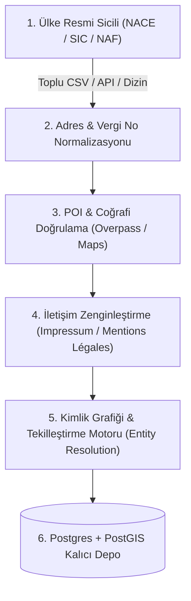

# B2B Veri Kazıma & Şirket Kimlik Grafiği Strateji Planı
> **Kapsam:** Global ve Türkiye B2B Denizcilik, Tekne & Yat Tasarımı, Tersane ve Mühendislik Veri Boru Hattı

---

## 0. Scrapling Nerede İşe Yarar, Nerede Yaramaz?

Scrapling'in gücü **anti-bot korumalarını aşma** ve **kırılan seçicileri (selector) kendi kendine onarma** tarafındadır:
- **`StealthyFetcher` / `StealthySession`:** Cloudflare Turnstile, Cloudflare Interstitial ve WAF engellerini bypass eder.
- **`DynamicFetcher`:** Headless browser ile dinamik JavaScript render eden portalları çözer.
- **`Adaptive Selectors`:** Hedef sitenin HTML DOM yapısı değiştiğinde akıllı eşleştirme ile doğru elementi otomatik olarak yeniden bulur.
- **`Spider` Altyapısı:** `robots_txt_obey` ve `crawldir` üzerinden oturum saklama ve artımlı (incremental) crawl imkânı sunar.

> [!IMPORTANT]
> **Doğru Aracı Seçmek:** Her veri kaynağı için Scrapling kullanmak gereksiz kaynak ve bant genişliği tüketir. Hedef tipine göre doğru araç seçilmelidir.

### Hedef Tipi ve Doğru Araç Matrisi

| Hedef Tipi | Örnek Kaynaklar | Doğru Araç | Neden? |
| :--- | :--- | :--- | :--- |
| **REST API** | Companies House, SIRENE, KVK, OpenRegister | `requests` / `httpx` | Doğrudan JSON döner, Scrapling overhead'ine gerek yoktur. |
| **Bulk CSV/XML/ZIP** | Companies House Snapshot, Sirene Bulk | `curl` / `wget` + `duckdb` / `pandas` | Milyonlarca satırı diskte streaming olarak işlemek en hızlısıdır. |
| **Klasik HTML Dizin & Sayfalama** | Stadtbranchenbuch, sektörel dizinler | `Fetcher` + `adaptive selector` | Hızlı HTML parse ve DOM değişikliklerine direnç. |
| **JS Render Eden Portallar** | MERSİS, İTO Bilgi Bankası, belediye portalları | `DynamicFetcher` / `DynamicSession` | Form submit ve AJAX render işlemlerini tarayıcı motoruyla çözer. |
| **Cloudflare / WAF Korumalı Siteler** | Ağır korumalı yabancı dizinler, tedarikçi listeleri | `StealthyFetcher` / `StealthySession` | Parmak izi gizleme, Turnstile ve JS challenge atlatma. |
| **Google Maps / Yandex Harita** | POI, koordinat, çalışma saatleri | Places API veya hazır scraper | Harita iç API'leri kırılgan olduğu için zenginleştirmede kullanılır. |

---

## 1. Ülke Bazlı Resmi Kayıtlar ve Açık Veri Envanteri

### 🇹🇷 Türkiye — En Zor Ülke (Ulusal Açık Veri Portalı Yok)
Türkiye'de merkezi ve toplu indirilebilir bir şirket açık veri seti bulunmamaktadır. Veriler dağınık, oturum korumalı veya form arkasındadır.

| Kaynak | Kapsam & İçerik | Erişim Biçimi | Not & Strateji |
| :--- | :--- | :--- | :--- |
| **MERSİS** | Tüm şirket/ticari işletme sicil kayıtları | Web Portal (Oturum zorunlu) | Resmi sicil kaynağı, API yok. `DynamicFetcher` ile form doldurma ve oturum yönetimi gerektirir. |
| **Türkiye Ticaret Sicili Gazetesi** | Tescil, unvan değişikliği, temsilci, terkin ilanları | Ücretli Veri Aboneliği (Düzey 1-2-3) | Toplu resmi veri için en gerçekçi yol; TOBB ile veri paylaşım protokolü. |
| **Oda Kayıtları (İTO, İZTO, ATO, BTSO)** | Üye firma listesi, NACE kodu, adres, durum | Web Form (Çoğu Captcha'lı) | Örneğin `eoda.izto.org.tr` veya İTO Bilgi Bankası unvan sorgusu. |
| **TOBB Sanayi Veritabanı** | ~70.000 üretici, kapasite raporu, ürün, çalışan bandı | Ücretsiz Abonelik + Oturum | Üretim, tersane ve ihracatçı hedeflemede altın değerindedir. |
| **TÜİK Veri Portalı** | Sektörel makro istatistikler | Açık Web / Portal | Firma bazlı değildir; ICP pazar büyüklüğü kıyaslaması için kullanılır. |
| **İBB Açık Veri Portalı** | İşyeri ruhsatları, istihdam, lojistik | Açık API | Şehir bazlı Türkiye'deki en olgun açık veri kaynağıdır. |
| **Diğer Belediyeler** | Ankara, Bursa, İzmir, Kocaeli açık veri dizinleri | Açık Portallar | `kaymal/acik-veri` dizini üzerinden takip edilir. |

> [!NOTE]
> **Türkiye Gerçeklik Notu:** Türkiye'de "tüm firmalar" havuzu kurmak için en sürdürülebilir yöntem Ticaret Sicili Gazetesi aboneliği almak ya da oda sitelerini hedefli olarak taramaktır. Oda sitelerini toplu kazımak oturum, captcha ve rate limit maliyetleri nedeniyle yavaş çalışır.

---

### 🇩🇪 Almanya — En Zengin Resmi + Açık Veri Ekosistemi

| Kaynak | Kapsam & İçerik | Erişim Biçimi | Not & Strateji |
| :--- | :--- | :--- | :--- |
| **handelsregister.de** | Resmi ticaret sicili, HRB/HRA, yöneticiler, ortaklar | Web (DiRUG sonrası ücretsiz) | Resmi API yoktur; `Scrapling / StealthyFetcher` tam buraya uygundur. |
| **OffeneRegister.de / OpenRegister** | Handelsregister'in CC BY 4.0 açık aynası | Açık REST API | Ücretsiz, yasal riski sıfır ve toplu alım için en rahat yol. |
| **Unternehmensregister / Bundesanzeiger** | Yıllık mali tablolar, bilanço bildirimleri | Web, kısmen açık | Finansal büyüklük ve ciro doğrulaması için. |
| **IHK Berlin Gewerbedaten** | ~350.000 işletme, sektör, hukuki form | Açık Veri (Aylık, WFS/GitHub) | Model veri seti; Hamburg, Köln, Münih IHK'leri için de geçerli. |
| **GovData** | Ulusal açık veri kataloğu | Açık Portal | Eyalet ve şehir veri portallarına tek noktadan erişim. |
| **Stadtbranchenbuch** | 5.6M+ işletme, telefon, web sitesi, adres | Klasik Web Dizini | İletişim zenginleştirmesi için mükemmel scraping hedefi. |

---

### 🇳🇱 Hollanda — KVK Merkezli, Açık Veri Kısıtlı

| Kaynak | Kapsam & İçerik | Erişim Biçimi | Not & Strateji |
| :--- | :--- | :--- | :--- |
| **KVK API** | Resmi Handelsregister sorguları, tam şirket kaydı | API Key (Ücretsiz katman var) | Ülkenin tek ve nihai resmi veri otoritesi. |
| **KVK Open Dataset (Basis Bedrijfsgegevens)** | Anonim temel veri, BV/NV tüzel kişilikler | Açık API + Toplu İndirme | İsim ve tam adres maskelenmiştir; kimlik grafiğinde tek başına yetersizdir. |
| **KVK Jaarrekeningen** | Yıllık mali tablolar (XML formatında) | Açık Bulk Veri | Bilanço ve finansal niyet sinyali çıkarımı. |
| **data.overheid.nl** | Ulusal açık veri portalı | Açık Web/API | Belediye ve bölgesel ticaret verileri. |
| **Telefoonboek.nl / Gouden Gids** | İşletme profili, telefon, e-posta, yetkili | Web Dizini | KVK kayıtlarını doğrudan iletişim verisiyle eşleştirmek için. |

---

### 🇬🇧 İngiltere — Açık Ara En Kolay ve Erişilebilir Ülke

| Kaynak | Kapsam & İçerik | Erişim Biçimi | Not & Strateji |
| :--- | :--- | :--- | :--- |
| **Companies House API** | Canlı şirket kayıtları, müdürler, tescil belgeleri | Ücretsiz API Key | 600 istek / 5 dakika sınırı; resmi ve anlık. |
| **Free Company Data Product** | Canlı tüm İngiliz şirketlerinin tam snapshot'ı | Açık CSV / ZIP İndirme | Tek dosyada ülkedeki tüm firmalar (~5 milyon satır). |
| **PSC Dosyası (Persons with Significant Control)** | Gerçek fayda sahipleri ve ortaklık payları | Açık JSON Bulk | B2B karar verici ve hissedar eşleştirmesi. |
| **FCA Register & Charity Commission** | Finans ve dernek sicilleri | Açık API | Finansal ve sektörel doğrulama. |
| **Yell.com** | İngiltere yerel işletme dizini, iletişim, web | Web Scraping | SMB/KOBİ seviyesinde güncel telefon ve web adresi. |

> [!TIP]
> **Lisans Güvencesi:** Companies House verisi **OGL (Open Government Licence)** altındadır; ticari ürünlerde kaynak belirtilerek tamamen ücretsiz kullanılabilir.

---

### 🇫🇷 Fransa — SIRENE ile Zengin ve Yapısal Kaynaklar

| Kaynak | Kapsam & İçerik | Erişim Biçimi | Not & Strateji |
| :--- | :--- | :--- | :--- |
| **API Sirene (INSEE)** | 1973'ten beri tüm işletme ve şube kayıtları | Ücretsiz API Key | Saniyede 7 istek limitli resmi API. |
| **Base Sirene Bulk** | Aylık tam şirket veritabanı snapshot'ı | Açık İndirme (CSV) | Milyonlarca Fransız işletmesini yerel veritabanına aktarmak için. |
| **API Recherche d'Entreprises** | İsim, NAF kodu, adres ve Siren/Siret sorgusu | Tokensız Açık API | Maksimum 10.000 sonuç tavanı; anlık zenginleştirme için ideal. |
| **INPI RNE / Data INPI** | Ulusal işletmeler sicili, tüzükler, bilançolar | Ücretsiz SFTP + API | Hissedar, imza yetkilisi ve mali tablolar için. |
| **BODACC** | İflas, konkordato, unvan devri, sermaye artışı | Açık Veri | Satın alma niyeti veya risk erken uyarı sinyali. |
| **PagesJaunes** | Fransız işletme rehberi, yerel iletişim verileri | Web Dizin Scraping | Doğrulanmış telefon ve web sitesi adresleri. |

---

## 2. Ülke-Üstü ve Sınır Ötesi Açık Veri Kaynakları

1. **GLEIF LEI (`api.gleif.org`):**
   - **Lisans:** CC0 (Tamamen kamu malı).
   - **İçerik:** Uluslararası tüzel kişi kimliği (LEI), ana şirket - bağlı ortaklık ilişkileri grafiği.
2. **OpenCorporates (`api.opencorporates.com`):**
   - **İçerik:** 200 milyondan fazla şirket, 100'den fazla yetki alanı; tüzel kişi tekilleştirmede global referans.
3. **Overture Maps & OpenStreetMap Overpass (`overpass-turbo.eu`):**
   - **İçerik:** Global POI (Point of Interest) katmanı, tersane koordinatları, limanlar. Google Maps'e göre ücretsiz ancak kapsama oranı %60–70 seviyesindedir.
4. **AB VIES (`ec.europa.eu/taxation_customs/vies`):**
   - **İçerik:** Avrupa Birliği KDV (VAT) numarası doğrulama servisi; sahte/inaktif şirketleri elemek için kritik.
5. **e-Justice BRIS (`e-justice.europa.eu`):**
   - **İçerik:** AB üye devletlerinin ticaret sicillerini birbirine bağlayan resmi tek kapı platformu.

---

## 3. Google Maps Yolu, Maliyetleri ve Hukuki Durum

| Yöntem | Yaklaşık Maliyet | Avantajları | Dezavantajları & Riskler |
| :--- | :--- | :--- | :--- |
| **Google Places API** *(Resmi Yol)* | Text Search ~$32 / 1.000 çağrı<br>Yorum Detay ~$40 / 1.000 çağrı<br>*(5.000 kayıt ≈ $245)* | Google Hizmet Şartlarına (ToS) %100 uyumlu, stabil, sıfır IP engelleme. | E-posta adresi vermez. Yorum saklama sınırı 30 gündür, en fazla 5 yorum döner. Pahalıdır. |
| **Hazır Scraper API'leri** *(Outscraper, SerpApi, Bright Data)* | $0,006 – $18,60 / 1.000 kayıt *(Ortalama ~$1,50 / 1.000)* | Web sitesi, e-posta, sosyal medya ve tüm yorumları zenginleştirilmiş verir. | Fiyatlar arasında 3.000 kata varan fark vardır. Hukuki risk sağlayıcıya aittir ancak gri alandadır. |
| **Kendi Scrapling Botun** *(StealthyFetcher)* | Sadece Proxy & Sunucu Maliyeti | Minimum maliyet, tam veri kontrolü. | Google'ın anti-bot güncellemelerine karşı kırılgandır, sık bakım gerektirir. |

> [!WARNING]
> **Altın Kural:** Google Maps asla birincil kayıt kaynağı yapılmamalıdır. Önce resmi sicillerden şirket listesi (tüzel kişi varlığı) çekilmeli, ardından Google Maps / Overpass sadece **iletişim zenginleştirme (telefon, çalışma saati, koordinat, puan)** için kullanılmalıdır.

---

## 4. Somut Uçtan Uca B2B Veri Boru Hattı



### Aşama Detayları:
1. **Resmi Sicilden Çıkarma:**
   - Birleşik Krallık: Companies House Bulk CSV → SIC `30.11` & `30.12` filtresi.
   - Fransa: Base Sirene Bulk → NAF `30.12Z` (Yat ve tekne yapımı).
   - Almanya: OpenRegister API → WZ Kodu `30.12`.
   - Hollanda: KVK API / Açık Veri.
   - Türkiye: MERSİS / Ticaret Sicili Gazetesi / Oda sorguları.
2. **Adres Normalizasyonu:** Cadde, ilçe, posta kodu ayrıştırma ve koordinat tespiti (Geocoding).
3. **POI Zenginleştirme:** OSM Overpass üzerinden tersane sahası kontrolü, gerektiğinde Maps API.
4. **Hukuki Sayfa Taraması (En Yüksek Verim):**
   - Almanya'da **`Impressum`**, Fransa'da **`mentions légales`** sayfaları kanunen zorunludur.
   - Tüm web sitesini taramak yerine sadece bu sayfaları `Scrapling` ile çekmek, şirket yöneticisi, doğrulanmış e-posta ve santral telefonunu doğrudan verir.
5. **Deterministik Tekilleştirme:** VKN / KVK / SIREN / VAT / LEI numaraları ile tekil `company_id` oluşturma.

---

## 5. Scrapling Temel Kod İskeleti

Aşağıdaki şablon, adaptive seçiciler ve oturum desteği ile dayanıklı bir sicil/dizin tarayıcısı sağlar:

```python
"""
NautiGraph B2B - Scrapling Dayanıklı Sicil ve Dizin Tarayıcısı
"""
import asyncio
from scrapling.fetchers import StealthySession, DynamicSession
from scrapling.spiders import Spider


class MaritimeRegistrySpider(Spider):
    name = "maritime_registry"
    start_urls = [
        "https://ornek-ticaret-odasi-dizini.org/sektor/yat-tasarim",
    ]
    crawldir = "./crawlstate"
    robots_txt_obey = True
    concurrent_requests = 4
    
    # Adaptive selector yapılandırması: DOM değişse bile elementi korur
    selector_config = {
        "adaptive": True,
        "auto_save": True
    }

    async def parse(self, response):
        # Şirket listesi satırlarını ayrıştır
        for row in response.css("table.company-results tr.item"):
            company_data = {
                "legal_name": row.css("td.name::text").get(),
                "city": row.css("td.city::text").get(),
                "tax_no": row.css("td.vkn::text").get(),
                "detail_url": response.urljoin(row.css("a.detail-link::attr(href)").get()),
            }
            
            # Detay sayfasına takip isteği gönder
            if company_data["detail_url"]:
                yield response.follow(
                    company_data["detail_url"],
                    callback=self.parse_detail,
                    meta={"company": company_data}
                )

        # Sonraki sayfa takibi
        next_page = response.css("a.pagination-next::attr(href)").get()
        if next_page:
            yield response.follow(next_page, callback=self.parse)

    async def parse_detail(self, response):
        company = response.meta["company"]
        # İletişim ve web sitesi zenginleştirmesi
        company["website"] = response.css("a.official-web::attr(href)").get()
        company["phone"] = response.css("span.phone-number::text").get()
        company["email"] = response.css("a[href^='mailto:']::text").get()
        
        yield company


# =============================================================================
# Cloudflare ve Dinamik Portallar İçin Özel Oturumlar
# =============================================================================

async def fetch_cloudflare_protected_directory(target_url: str):
    """
    Cloudflare Turnstile veya WAF arkasındaki dizinleri aşmak için StealthySession kullanımı.
    """
    async with StealthySession(solve_cloudflare=True, humanize=True, geoip=True) as session:
        response = await session.get(target_url)
        return response.adaptive_select("div.supplier-card")


async def fetch_dynamic_portal_with_login(login_url: str, target_url: str, credentials: dict):
    """
    Oturum ve JavaScript gerektiren Türk kamu/oda portalları için DynamicSession kullanımı.
    """
    async with DynamicSession(headless=True) as session:
        # 1. Giriş yap
        await session.goto(login_url)
        await session.fill("#username", credentials["user"])
        await session.fill("#password", credentials["pass"])
        await session.click("#btn-login")
        await session.wait_for_selector(".user-dashboard")
        
        # 2. Yetkili oturumla hedef dizini çek
        response = await session.goto(target_url)
        return response.css("table.registry-list")
```

---

## 6. Proje Entegrasyon Notları (NautiGraph TR)

1. **`business_manager/app.py` Entegrasyonu:**
   Toplayıcı kuyruk motoru (`CRAWLER_STATE`), yukarıdaki akışa göre ülke seçildiğinde ilgili boru hattını devreye alır:
   - `Türkiye` seçildiğinde: `musteri_listesi.json` yerel sicil verisi + Sanayi veritabanı.
   - `İngiltere` seçildiğinde: Companies House Bulk CSV ve REST API.
   - `Almanya` seçildiğinde: OpenRegister API + Impressum crawl.
   - `İtalya & Hollanda` seçildiğinde: KVK / Registro Imprese ve sektörel fuar katılımcı listeleri.

2. **Hukuki Dayanak (KVKK & GDPR):**
   Tüzel kişi tacir kayıtları kamuya açık sicil kapsamındadır. Ancak web sitelerinden çekilen şahıs iletişimleri için **meşru menfaat denge testi (KVKK md. 5/2-f / GDPR Art. 6/1-f)** kayıt altına alınmalı ve **İYS / ROKS** ret mekanizması açık tutulmalıdır.
